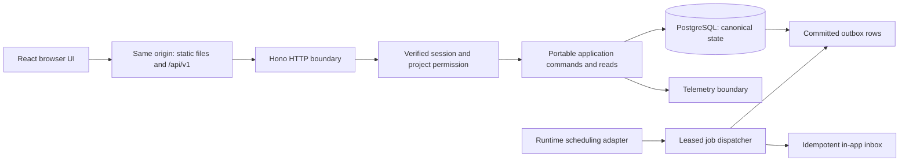

# Flowboard architecture v0.3

Updated 2026-10-26. Status: v0.3 implementation plan; first local foundation task handed off. See PROGRESS.md and role-owned handoff evidence for current runtime state; no hosted deployment/auth readiness is established by this document. User priorities: performance first, free-tier start, portable modules, explain decisions while building.

## Decision and alternatives

Recommend **React + Vite + strict TypeScript**, **Hono** HTTP handlers, **PostgreSQL** with **Kysely + pg**, and **Cloudflare Workers** for the initial static frontend/API host. Pilot database provider: **Neon**, accessed from Workers through **Hyperdrive with query caching disabled**. Exercise the same API/domain services through a **Node entry point/container** with local PostgreSQL. Pilot Better Auth OAuth + DB sessions, subject to a runtime/CPU/connection compatibility spike; login providers and audience remain open.

This supersedes the D1 recommendation because standard PostgreSQL transactions and schema continuity better match the revised portability and concurrency priorities. It is not a measured speed ranking. The D1 prototype remains under database/prototypes/d1 and its 11 SQLite tests remain historical evidence. No PostgreSQL migration has been written or tested yet. Original decision: [v0.1 history](docs/decisions/0001-d1-initial-proposal.md).

| Choice | Why this baseline | Real alternative / tradeoff |
|---|---|---|
| React/Vite SPA | Board interactions dominate; static assets move between CDNs | SSR framework if public SEO/server-rendering becomes a requirement |
| Hono | Thin Web Request/Response boundary; Worker and Node targets | Fastify for a Node-first deployment; do not choose by hello-world benchmarks |
| PostgreSQL | Interactive transactions, mature indexing/plans, same engine across hosts | D1 simpler Cloudflare integration; changing engines later costs more |
| Neon | Independent managed PostgreSQL pilot with a free plan | Supabase offers integrated auth/files/realtime, adding service-specific coupling if used directly |
| Kysely + pg | Typed queries while keeping joins/locking/transactions visible | Plain parameterized pg SQL is simpler conceptually; Drizzle is also viable but not engine independence |
| Workers initially | Managed ingress/static delivery and low-cost pilot | Node colocated with DB can win for multi-round-trip transactions; benchmark both |
| Better Auth proposal | OAuth/session data under our control | Managed identity lowers operations but replacing sessions/providers still needs migration |

Primary sources, quota caveats and full comparison: [stack research](docs/research/stack-comparison.md). Dependency versions are pinned after compatibility testing, not guessed now. Free-tier sleep/CPU/statement limits can conflict with performance; no always-free, always-warm promise.

## Structure and boundaries

```text
apps/web/                    React board/dialog; API client; no database credentials
apps/api/src/http/           Hono routes, validation, session/CSRF middleware
apps/api/src/application/    Commands, reads, permissions, transaction use cases
apps/api/src/domain/         Workflow, ordering and other pure business rules
apps/api/src/adapters/       PostgreSQL, identity, objects, jobs, telemetry
apps/api/src/runtime/        Worker fetch/scheduled/queue + Node entry points
packages/contracts/         Shared validated API schemas, types and fixtures
database/migrations/        Future selected PostgreSQL migrations
database/prototypes/d1/     Superseded executable SQLite design
docs/references/            Every original UI reference and catalogue
docs/research/              Source-backed research; alternatives are not contracts
docs/decisions/             Why important choices changed
scripts/                    Local verification and future integration tooling
```

Folders above are a target layout, not a claim they all exist. Use a modular monolith: one coherent application, clear modules and one canonical database. A module boundary is a separation in code; a microservice also creates network, deployment and consistency costs. We need the former now.

This describes how we organize and release business logic, not a one-server restriction. Multiple stateless instances can run the same application. A scheduled notification dispatcher can share the application modules without making every capability a separately deployed microservice. Extract a service only for a measured independent scaling/ownership need; preserve contracts and account for network failures and separate transaction boundaries. See [the plain-English comparison](docs/LEARNING.md#monolith-modular-monolith-and-microservices).

Only adapters/runtime wiring know Cloudflare bindings, provider IDs, native queue handles or object SDKs. Application/domain modules use narrow transaction, identity, object, job and telemetry capabilities where justified. Do not invent a universal database abstraction: PostgreSQL SQL remains deliberate and portable between PostgreSQL hosts, not automatically between engines.

## Data flow



Cloudflare deployment: Worker → request-scoped pg connection → Hyperdrive → Neon direct PostgreSQL endpoint. Do not stack poolers by accident. Node deployment: Hono Node adapter → bounded process pool → PostgreSQL. Every transaction stays on the same checked-out client. Hyperdrive session state must not be assumed to persist; tenant settings, if adopted, are transaction-local. Source: [connection and driver research](docs/research/stack-comparison.md#connection-and-transaction-design).

All browser API traffic stays same-origin. `/api/*` runs before SPA fallback and never returns index.html for errors. Authenticated data is private/no-store initially. Trust forwarded headers only from configured ingress. Keep database origin and runtime placement close enough for measured transaction latency; a nearby edge server alone does not remove database round trips.

## Canonical data and tenancy

Workspace → project → board → column → card. One workspace owner accesses all owned projects; other accounts need explicit project_memberships with manager/member/viewer role. Board/card/comment/image/import/history access inherits the project grant, never workspace membership alone. User confirmed Owner and Project Manager administration; only Owner appoints/removes managers. [FEATURE_SPEC.md](docs/FEATURE_SPEC.md) and [API v0.3](docs/API.md) supersede older scope. Active/restorable cards keep column references; removing their column is blocked. Purged tombstones preserve minimal audit/import identity without deleted content.

Use composite tenant/board foreign keys, unique identity/receipt/assignment/notification keys and indexes matching actual reads. Foreign keys prevent invalid relationships; authorization decides who can use a valid relationship. They solve different problems. PostgreSQL RLS is optional defense in depth, only after non-bypass runtime roles and pooled tenant context are tested; it does not replace application checks.

Store date-only deadlines as DATE and instants as timestamptz. Preserve dueDate YYYY-MM-DD in JSON, and derive today in the workspace timezone. Validate text, mentions, dates and all relation IDs at the server. UI displays actual data coverage/counts and explicit pagination, not inferred completeness.

## Writes, locks and ACID

Atomicity means a move, event and receipt all commit or none do. Consistency means our constraints/invariants remain true. Isolation controls what concurrent transactions can see. Durability concerns surviving acknowledged commits and recovering data; backup/restore evidence is still required. A local rollback test establishes only a portion of these properties.

Use short PostgreSQL Read Committed write transactions with explicit conditional versions and row locks on shared ordering state. Proposed command:

1. Resolve the authenticated actor; begin a transaction on one pg client.
2. Lock/check current owner or explicit project grant and active project/board state. Lock relevant actor/assignee/mention grants in a documented deterministic order before ordering/card rows, so concurrent revocation/demotion cannot bypass authorization or new-recipient eligibility. All write, membership, archive and purge workflows follow that common order.
3. Look up the scoped idempotency receipt; verify method/path/body hash and current access before replaying it. Uniqueness handles duplicate-key races; loser rolls back and reads the winning receipt.
4. Lock board ordering row, then affected cards in deterministic ID order. Recheck expected card/structure versions and canonical neighboring card IDs within the transaction. Never perform provider calls while holding these locks.
5. Compute sparse integer rank; compact destination ranks if necessary. Apply state, version increments, receipt, immutable activity and outbox atomically. Throw on lost CAS or invalid ancestry; do not treat zero rows as success.
6. Commit, release the connection and return canonical state. Dispatch notifications later. Bounded whole-transaction retry applies only to classified deadlock/serialization failures, with the same idempotency intent.

Owner transfer and project-membership operations also lock the relevant workspace/members in a consistent order; last-owner, assignee/mention eligibility and revoked-access races need explicit tests before those commands are enabled. Database locks protect overlapping server work; optimistic versions protect a user editing an old screen. Both are useful here.

Card/comment version protects field edits. Board structure_version protects create/move/delete/restore/column changes. Board snapshot_version advances for every card/column mutation, including filter-affecting field edits and count-affecting discussion/image changes. Cursor scope binds workspace, board, filters and snapshot revision. A stale cursor returns 409 and asks for refresh.

Use a short **read-only Repeatable Read transaction** for multi-SELECT board snapshots, or a proven single-statement snapshot. Read Committed gives each statement a new snapshot and is insufficient for a consistent metadata/counts/cards response across several SELECTs. Return bounded per-column pages and full scoped counts; use joins/batched relations, never one query per card. Cursor revisions govern later requests; they do not hold a DB transaction open across browser pages.

## Async work and consistency

Canonical writes stay within one PostgreSQL transaction. In-app notifications can arrive later: committed outbox rows are claimed in bounded batches with leases, retry deadlines, exponential backoff and jitter; duplicate consumer attempts converge through unique event/recipient keys. Poison work moves to an inspectable failed state with an audited replay path. An outbox is a durable to-do list saved with the card change, so a crash cannot quietly forget to notify.

Use a scheduler adapter for polling that outbox, with overlap-safe claims and catch-up. `waitUntil` or an in-process promise is not a durable job system. Invitation email, mention inbox, image verification/cleanup, trash purge and import validation use durable job adapters as needed. An invitation email integration is required before real invites; local sink testing is separate evidence. Dedicated Cloudflare Queues comes later if backlog/throughput or isolation merits it; AWS/Azure equivalents need their own retry/DLQ/lease implementations. Delivery is at least once, with idempotent effects; do not promise exactly once across services.

Foreground revision polling/refetch first, with hidden-tab pause, adaptive interval, jitter/backoff and quota accounting. Changing comments/inbox can occur without structure revision; refetch the relevant resource. Later realtime broadcasts committed IDs/versions and refetches after reconnect/gaps. No offline write queue or collaborative text editing initially. Audit history is not event sourcing, and separate query/command functions do not require CQRS infrastructure.

## Performance and resilience gates

First build a thin vertical slice: authenticated board read → versioned move → comment/outbox. Run the same workload through Worker and Node entry points against the same PostgreSQL region/tier. Separate warm behavior from database suspension/process starts. Record p50/p95/p99, browser input-to-paint, CPU, query count, SQL/lock/pool wait, bytes, conflicts/retries and quota consumption.

Proposed—not achieved—targets for the primary user region: p95 warm board snapshot ≤500 ms, committed move acknowledgement ≤300 ms, optimistic feedback ≤100 ms. Test 1/10/25 concurrent users and growing datasets; budget a separate stress run. Detailed run caps and cold-start protocol are in stack research. Workload, geography and budget remain assumptions until the user clarifies them.

Bound body sizes, page sizes, job batches, concurrency, pools, retry attempts and request deadlines. Under pressure, shed controlled 429/503 responses rather than queue unlimited work. Rate limits used for abuse prevention may be approximate; business quotas need an authoritative atomic counter. Dependency breakers are introduced only with a defined scope and recovery test. Idempotency precedes retry.

Tune queries and indexes before adopting caches/replicas/shards. Private board/auth caching remains disabled. If caches become justified, define tenant keys, TTL/version invalidation, coalesced misses, safe staleness and fallback; Redis eviction must never destroy canonical state. Use replicas for measured read pressure, keep revocation and post-write reads primary, and test lag. Partition large history only when plans/retention justify it. Shard by tenant only after evidence demands it.

## Runtime operations and observability

Provider ingress handles initial balancing. Stateless API instances share DB-backed sessions and canonical data; per-process memory is not authority. Node drain closes ingress, bounds in-flight work and releases pool/job leases on SIGTERM. Worker lifecycle is deadline-bound; unfinished durable jobs must be recoverable independently. Prove crash/reclaim behavior on both runtime adapters.

Separate liveness from readiness, bound dependency checks and expose no credentials. Add request IDs plus portable trace context across HTTP, SQL and outbox; redact tokens/content, sample deliberately and measure overhead. Track lock/pool waits, retry/error rates, outbox age, failed work, DB capacity and free-tier headroom. Alert thresholds and SLOs require measured baselines.

Before integrations: verify webhooks against raw body/signature/provider freshness policy, persist/deduplicate receipt before acknowledging, and test replay/tampering. Outbound hooks use bounded signed retries and failed-work recovery. No webhook endpoint is enabled just because its design exists.

## Migration and provider exit

Separate local/dev/UAT/production data, secrets and resources. SQL migrations are versioned, single-runner, additive first; practice old/new app coexistence and index/lock effects. Worker rollback does not roll back database data. Compatibility and backup restoration are release evidence, not guarantees from this document.

Phase 1: run Node locally with the same PostgreSQL services and contract tests. Phase 2: build/run a Node container and deploy a nonproduction AWS/Azure rehearsal if needed. Keep Neon initially to isolate compute changes. Phase 3: rehearse PostgreSQL export/restore into compatible RDS/Azure PostgreSQL, validate counts/constraints/roles/TLS and switch during a bounded write freeze. Define rollback before reopening writes; switching back after new writes requires reconciliation.

Private reference-image storage is now release scope: use stable keys/metadata in PostgreSQL and a private initial R2 adapter. Current project authorization gates every image/thumbnail proxy request; public buckets or reusable links cannot bypass revocation. Enforce image content/size/dimension/count limits and safe upload-finalize/orphan cleanup. Card trash preserves finalized images until the exact 24-hour restore cutoff; fenced purge cannot race a successful restore. Object storage uses stable keys and metadata, not permanent provider URLs. R2/S3-compatible operations form a narrow adapter; Azure Blob still requires separate implementation and data copy/checksums. Jobs, realtime, IAM, secrets and observability also need provider-specific migration. Portability means known boundaries plus tested exit steps, not a zero-work switch.

## Living control documents

All **50 concerns have a design/acceptance plan** in [ENGINEERING_CHECKLIST.md](docs/ENGINEERING_CHECKLIST.md); delivery boxes remain unchecked until actual implementation and validation. [TASKS.md](TASKS.md) holds small ordered steps, [PROGRESS.md](PROGRESS.md) records evidence/issues, [DESIGN.md](DESIGN.md) guides UI, and [RULES.md](RULES.md) governs code and teaching format. Backend/UI must read [the single reference catalogue](docs/references/README.md).

Outstanding inputs: verify GitHub push access and load/verify the user-approved Cloudflare connection, choose login audience/provider, clarify geography/expected team size, and review the first visual flow. Do not ask the user to repeat Cloudflare consent merely because tools are not yet loaded. No app benchmark, production claim or paid resource creation is authorized by an architectural recommendation alone.

## Feature-first implementation revision

[98 feature definitions](docs/FEATURE_CHECKLIST.md), detailed [product flows](docs/FEATURE_SPEC.md), [Excel import contract](docs/IMPORT_SPEC.md) and [Backend-to-UI handoffs](docs/handoffs/README.md) are now mandatory implementation inputs. Research this iteration used three GPT-6 Luna agents. Product work follows Backend verification → UI implementation → integrated acceptance per feature, with separate role-owned evidence files.

Deletion is active → trashed → restored active or purged, with strict server now < restoreUntil and an asynchronous fenced cleanup job. Project/board archive is distinct and does not extend deadlines. Receipts/history/inbox/error records must not retain raw deleted-content copies that bypass purge; store minimal operation outcomes and safe tombstones. Restore and source-import dedupe preserve original identity.

XLSX import selects a project/board in the app, parses only bounded literal data, previews without domain-card writes and requires explicit confirmation. Same source ID plus original payload is skipped; changed payload conflicts; removed membership/columns/users invalidate preview. Atomic new-card commit is bounded to a proposed 200-row batch; parsing and uploads run outside locks. Worker runtime/CPU compatibility needs measurement; an adapter change must preserve user-visible atomicity, authorization and retry behavior.


## User-confirmed Projects access revision — 27 October 2026

The user explicitly chose **separate access for each board** and **combined card views only within one project**. This supersedes earlier statements that project grants automatically expose all child boards, and withdraws cross-project/workspace card aggregation. Keep workspace → project → boards → columns → cards; do not introduce nested project entities. For non-Owners the proposed effective read boundary is active project membership AND an active grant to that board. The Owner retains access to all boards in owned projects. A person can see an accessible project while having zero accessible boards; do not reveal hidden board names, IDs, counts or cards. Owner-only board grant administration is the initial UI preview default; Manager delegation and existing-data grant backfill still need an explicit backend/product decision.

The local Projects prototype implements synthetic visibility and an Owner access editor. This does not change current API authorization or prove server enforcement. Backend work is handed off through docs/handoffs/proposals/project-board-access-v2-2026-10-27.md; all affected reads/writes and revocation paths must be migrated and independently verified before integration. Existing failed backend handoffs remain separate.
