# Hosted MCP Implementation Plan

> For agentic workers: use subagent-driven execution for independent file-owned streams; verify each frozen slice before downstream implementation.

**Goal:** Colleagues connect Claude to Flowboard through a hosted URL and browser consent without terminal/token handling.

**Architecture:** Existing Worker modular API, same-origin Pages, PostgreSQL OAuth state and existing five tools. Request-local SDK server and trusted in-process operation dispatch retain the existing card/grant/receipt implementation.

**Tech Stack:** Hono, TypeScript, PostgreSQL, Next.js static Pages/Functions, MCP SDK1.32.2.

**Spec:** [HOSTED_MCP_SPEC.md](HOSTED_MCP_SPEC.md). User selected this direction and authorized build/test/UAT; implementation details are Architect choices rather than additional user promises.

## Strategic delivery plan — user-directed 60-minute development target

The user requested a full strategy, Architect-led assembly/review and parallel builders, aiming to finish development in60minutes without compromising quality. This supersedes the earlier broad estimate as a target, not a guarantee. Deep testing, independent acceptance, CI and deployment are tracked separately; ordinary compile checks and focused developer regressions remain part of responsible development. At60minutes report the real state and remaining work rather than mark incomplete work done.

### What success looks like for a colleague

1. In Claude, add the Flowboard hosted connector URL.
2. The browser opens Flowboard sign-in if needed, preserving the pending connection safely.
3. The consent screen shows who is asking, the callback host, requested actions, continuing-access duration and a project chooser.
4. The user selects one project and approves, or denies without granting anything.
5. Claude returns connected and can discover permitted boards/columns, search cards and create a card in an explicitly chosen destination.
6. Flowboard's personal Connections screen shows the connection and lets the same user disconnect it. Subsequent requests stop working after revocation.

No teammate installs Node, clones Git, opens developer tools, edits JSON or copies credentials. A project restriction is a smaller permission slip, not new access: existing role and explicit board grants still govern every operation. Existing local MCP and ordinary browser/PAT operations remain supported.

### System map and reusable pieces

```mermaid
sequenceDiagram
    participant C as Claude
    participant P as Pages proxy
    participant A as Hono Worker
    participant U as User browser
    participant D as PostgreSQL
    C->>P: Connect to /api/v1/mcp
    P->>A: Same-origin request
    A-->>C: 401 plus OAuth discovery
    C->>U: Open authorization flow with PKCE
    U->>A: Existing Google session and explicit project consent
    A->>D: Store one-use code and restricted connection
    A-->>C: Exact validated callback
    C->>A: Exchange code plus verifier
    A-->>C: Short-lived access and rotated refresh credentials
    C->>A: MCP tool with access credential
    A->>D: Current authority + existing transactional card operation
    A-->>C: Bounded result
```

PKCE means the one-time sign-in code works only for the client instance holding its matching verifier. Refresh lets a colleague stay connected without repeated sign-in; rotation prevents a stolen old refresh token being reused unnoticed. PostgreSQL remains the source of truth for consent, credentials and revocation. No separate auth provider or microservice is introduced.

### Parallel workstreams and ownership

| Stream | Owner | Deliverable | May run in parallel with | Must wait for |
|---|---|---|---|---|
| Architecture/contracts | Architect | Frozen public paths, schemas, scopes, trust boundaries, criteria, dependency/build wiring | All research and bounded builders | User scope, already approved |
| OAuth backend | Auth builder | Migration27, client registration/discovery support, pending consent, code/refresh/revoke, connection API, focused DB regressions | Transport and Architect review | Shared contract |
| MCP/runtime assembly | Transport builder | Shared five-tool factory, stateless HTTP, private Request capability, app/auth/card integration and runtime regressions | OAuth builder on separate files | Stable adapter exports; complete auth implementation for integrated proof |
| UI planning | UI builder | Consent/Connections layout, sign-in return path and Pages proxy plan | Both backend streams | No implementation prerequisite for planning |
| Backend acceptance | Fresh auditor plus Architect primary review | Immutable target, attack evidence, scores and actual contract handoff | UI planning, documentation | Backend wired/held and required local checks |
| UI implementation | UI builder | Consent and Connections pages, safe-next/proxy/navigation, frontend checks | Independent checks of held backend scope | Verified backend handoff under repository feature-first rule |
| Final integration/release | Architect plus fresh whole-feature auditor | Complete regression/CI evidence, clean named artifacts and UAT-only release | Documentation and read-only deployment discovery | Integrated source hold and passing gates |

Each shared file has one editor. Transport owns app.ts, auth.ts, cards.ts, activity.ts and private dispatch during assembly; Auth owns its new adapter/routes/config/migration and rate-map edits; Architect owns contracts/root package manifests; UI owns apps/web after its gate. Builders do not edit another stream's files or score their own work. Architect reviews builders and resolves integration decisions; a fresh independent auditor assesses the full target wherever Architect-authored shared code is included.

### 60-minute development schedule and critical path

Use elapsed minutes from this strategy's kickoff; completed drafts are reused rather than rebuilt. Milestones can overlap only where dependencies permit.

| Target | Work | Concrete exit evidence |
|---|---|---|
| 0–10min | Confirm scope, freeze shared payloads/ownership, inspect drafts and record baseline | Spec/plan, exact exports, baseline branch/commit, file ownership agreed |
| 0–25min | Auth and transport finish their separate source slices; Architect reviews source/contracts while they build | Adapter and transport source, migration27 parity, compiler output, focused developer results |
| 15–35min | Wire private operation dispatch, metadata and app middleware; prove no PAT/REST bypass or single-pool deadlock | Mounted handler paths, compile and targeted authority/runtime evidence; source held for backend audit |
| 25–40min | Backend contract acceptance as soon as evidence is ready; UI planning continues | Independent backend verdict/handoff; no UI API integration before a valid pass |
| 35–55min | Consent/Connections UI, Google resume, proxy and all-role navigation | Frontend source, build/typecheck, contract-consumption and focused browser evidence |
| 50–60min | Assemble complete candidate, inspect cross-stream diffs and document gaps | One named development candidate with backend/transport/UI wired; no placeholder counted complete |

The critical path is backend authority → mounted integration → backend review → UI integration. If that path exceeds the budget, continue beyond60minutes. Do not bypass its gate, omit consent/revocation, relax token binding or deploy to meet a clock. Work still in progress at the checkpoint stays unchecked. Review/CI/hosted acceptance can extend total delivery substantially beyond the development target.

### Development complete versus release accepted

- **Source built:** real backend/transport/UI code is assembled and compiles, including the Pages Functions and database migration. This is the development milestone, not permission to release.
- **Locally verified:** required focused/whole suites and real Node/workerd/PostgreSQL/browser checks pass on the frozen candidate. Synthetic sign-in is labeled as synthetic.
- **Independently approved:** exact source/evidence manifest, all category floors, score strictly above8.5, no hard blockers and no required command missing/failing. Architect does not self-certify authored code.
- **UAT deployed:** exact approved Worker/Pages artifacts and migration are applied only to the identified UAT resources; provider IDs and rollback state recorded.
- **Hosted accepted:** actual browser sign-in/consent and real Claude connection/revoke/refresh outcomes are recorded. The user's earlier successful local Claude connection is regression-baseline evidence, not acceptance of this new browser OAuth flow.

### Verification and security strategy

| Layer | Evidence required |
|---|---|
| Shared contracts | Strict input/response schemas reject arbitrary callback/scope injection, missing allow-project and credential fields in consent/connection responses. |
| OAuth state | Wrong client, redirect, audience, verifier, session/browser binding, CSRF, expiry/replay, concurrent code use, refresh rotation/reuse, disconnect and rollback on real isolated PostgreSQL. |
| Authority | Owner with inherited access, Manager/Member/Viewer, no board grants, sibling scope, role/membership/grant removal, archive/deletion, retry after revocation; no metadata/card/count leakage. |
| Runtime protocol | Initialize/notification/list/call/error behavior, no cross-user sessions, body/depth/batch/Accept/Origin limits, true401 discovery, fresh transport cleanup, real workerd and one-connection dispatch. |
| Browser | Google next-path retention, approve/deny/expired request, session switch, consent text and no token storage, keyboard/focus/error states, personal disconnect reachable to all roles. |
| Compatibility | Existing stdio/PAT executable, API routes, card/receipt/provenance and existing product suites; no source-line claim substitutes for executed checks. |
| Release | Full required CI commands, clean commit/artifact hashes, current account/resource identity, backup/migration verification, bounded public smoke and actual owner/provider checks. |

Keep all failed commands and review rounds. Reproduce important findings independently. Three failed review rounds trigger the existing escalation rule. No source mutation during an auditor's held scope; a repair creates a new target.

### Operational bounds and principal risks

| Risk | Mitigation and proof |
|---|---|
| OAuth admitted as an ordinary API credential | Exact MCP entry gate plus private Request identity; OAuth bearer rejected by REST/session/PAT-admin routes; forged identity headers tested. |
| Credential theft or token/code copies | Hashed opaque state, one-use short codes, S256, exact resource/callback/client binding, no logs/browser storage, scope/TTL/rotation/revocation tests. |
| Leaking a hidden board/project | Consent restricts one project; existing current board grants and safe projections apply inside every tool and retry. |
| Refresh racing a write or producing duplicate cards | Connection-scoped stable receipt identity, credential row locks and current-grant checks in the existing transaction; separate-connection race tests. |
| Worker deadlock/connection amplification | Reuse one trusted request-scoped pool, release verification queries before dispatch and never hold a transaction while checking out the same sole connection again. |
| Client metadata SSRF/registration flooding | Exact HTTPS trusted origin, no redirects/cookies, fetch byte/time bounds, metadata identity/callback checks; rate/retention caps preserve live clients. |
| Google login loses the consent continuation | Explicit bounded safe-next route/query in API, client gate and Pages middleware; real browser roundtrip test. |
| SDK/client evolution | Keep installed SDK protocol claims explicit; exercise real SDK client and official Claude discovery requirements; do not silently claim future-protocol support. |
| Disrupting current UAT testing | Local branch/work only until gates pass; additive migration; announce promotion; record existing artifacts/version IDs and rollback limits before writes. |

### UAT rollout and recovery

Reverify the exact UAT Cloudflare/Neon targets and current deployed artifact, since the user is testing there. Refresh the already-approved encrypted backup outside Git, verify it, apply only missing reviewed migration27, and capture the ledger. Never modify production or remove existing PAT credentials/connections as cleanup. Deploy Worker explicitly with --env uat and Pages to flowboard-app-uat; capture exact commit/bundle/Pages hashes and provider IDs. Use IPv4-first CLI networking if the earlier diagnosed Node connection issue recurs.

For a failed upload, check live versions before retrying. For a migration failure, inspect the ledger before any retry; do not run destructive resets. Roll back application artifacts if appropriate, retaining additive OAuth schema/state unless a separately reviewed recovery requires otherwise. An old application will not expose the new connector, so document that loss of capability honestly. Do not claim an untested database restore. User can close the laptop only after active deployment processes and required immediate checks finish and checkpoint files are saved.

### Deliberately outside this delivery

Company machine-to-machine client_credentials and durable fleet incident identity; MCP update/delete-card tools; generalized third-party redirect registration/native loopback production clients; offline writes; multi-project consent in one connection; automatic approval without user consent; SDK major migration; public connector-directory publication. These require separate explicit scope and acceptance, not shortcuts within this feature.

### Progress reporting and checkpoints

Update the checkbox list below after each actual milestone. Each status report states **done, in progress, blocked, next** with one concrete result. Distinguish drafts, compiled source, local tests, independent approval and UAT acceptance. At60minutes provide the real remaining critical path, not a revised success label. Current public UAT remains d1c81f4 until an announced, verified promotion.

## Global constraints and review focus

- UAT only after passing local/independent gates; production excluded. Current UAT d1c81f4 stays available during local work.
- Single explicit project consent; live board authority; exactly five tools, existing stdio/PAT behavior preserved.
- Test actor/session/browser swaps, code/refresh races, revoked grants at retry time, callback/CIMD SSRF tricks and single-connection Worker dispatch deadlocks.
- Reuse stable connection-based receipt identity across refresh; never fake a PAT or trust identity headers.
- Preserve prior failed/passing evidence and unrelated checkout work; score cannot waive required failures.

## Tasks and exact ownership

- [x] HMCP-00: Inspect existing source and current official Claude/MCP docs; freeze spec, ownership and shared contract before assembly. Research notes in docs/decisions/2026-11-04-hosted-mcp-*.md.
- [ ] HMCP-01: Architect writes packages/contracts/src/hosted-mcp.ts plus meaningful strict schemas/tests and exports. OAuth builder consumes it; no shared payload drift.
- [ ] HMCP-02: OAuth builder writes migration0027 and new backend adapter/config/routes, tests failing first then passing real PostgreSQL. Exports HostedOAuthPrincipal, verifyHostedAccessToken and lockHostedOAuthCredential as specified. No shared app/auth/card edits by builder.
- [ ] HMCP-03: Transport builder extracts side-effect-free server factory and FlowboardOperationsClient; preserve CLI behavior and validate both stateless HTTP/stdio artifacts. Architect adds API workspace dependency/exports/declarations/build order with unchanged pinned SDK.
- [ ] HMCP-04: Architect adds private request-capability dispatcher, app/auth/card/provenance integration and mounted identity/refusal/concurrency tests. Verify single-pool workerd behavior; no live DB for probes.
- [ ] HMCP-05: Freeze backend/transport slices and obtain fresh independent acceptance under BACKEND_REVIEW_GATE; preserve failures and record exact required checks, source/evidence and category scores. Only verified shared APIs can be handed to UI.
- [ ] HMCP-06: UI builder implements /connect and personal Connections, safe-next/Google resume, exact well-known proxy and all-role navigation; actual browser happy/deny/expired/revoke/role checks with synthetic actors.
- [ ] HMCP-07: Full local/CI and fresh whole-feature independent review; revalidate changed/shared existing functionality, generate truthful checklist evidence and record any hosted-only pending cases. No self-ratings or blind old record cloning.
- [ ] HMCP-08: Clean named candidate artifacts; reverify UAT identities, fresh approved encrypted backup and missing reviewed migration0027 only; deploy UAT Worker/Pages with rollback IDs and explicit user progress update. Never bare production deployment.
- [ ] HMCP-09: Hosted discovery/401/metadata/protocol smoke plus actual browser Google/consent/Claude connect/revoke where available. Distinguish external-client owner steps from executed tests. Save safe-to-close checkpoint and colleague-friendly connector instructions.

Each completed item links its exact target, commands/exits/counts, independent record and limitations. Evidence: docs/reviews/HOSTED-MCP-20261104/.
