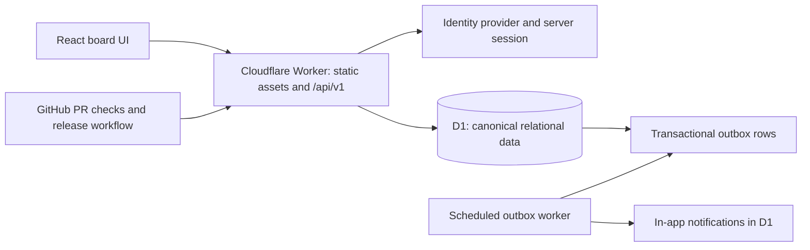

> Historical v0.1 proposal, retained for decision provenance. Superseded by the root ARCHITECTURE.md after the v0.2 portability review. Not implementation instructions.

# Architecture v0.1

Date: 2026-10-26 (Asia/Kolkata). Status: recommended baseline; no application deployed.

## System

Recommendation: a TypeScript monorepo, React + Vite frontend in `apps/web`, a small Workers API in `apps/api`, shared schemas/types in `packages/contracts`, and SQL migrations in `database/migrations`. Keep UI and domain code independent of Cloudflare binding types. Use a single public origin, routing `/api/*` to the Worker before SPA fallback. API errors must never return the SPA HTML.

Workers can serve static assets alongside server code; GitHub Actions can deploy Workers using scoped secrets. These are documented platform capabilities, not evidence that our account is connected. Sources: [Workers static assets](https://developers.cloudflare.com/workers/static-assets/), [GitHub Actions](https://developers.cloudflare.com/workers/ci-cd/external-cicd/github-actions/).

## Database decision

Use D1 for the first small-team release: relational cards, membership, comments and history with SQL constraints, no separate database host. D1 is SQLite-based; do not write PostgreSQL-specific migrations. Its single-database write capacity and size limits are constraints, not an assumption of unlimited edge scale. Re-evaluate after measuring board load, write latency, scanned rows and storage.

Use primary reads initially; do not enable read replicas or cache authenticated board responses until read-after-write and revocation behavior are tested. Use parameterized queries and indexed workspace/board lookups. KV is not authoritative storage for membership, sessions, ordering or idempotency.

If scale, row-level security, complex reporting or interactive transactions demand PostgreSQL, use an external managed PostgreSQL service through Hyperdrive, with caching disabled for mutable collaboration queries. This adds a provider and migration work; it does not make PostgreSQL hosted by Cloudflare. See [backend research](../research/backend-research.md) for verified platform limits and tradeoffs.

## Consistency and movement

D1 `batch()` runs prepared statements atomically and rolls back on statement failure. It is not an interactive read/compute/write transaction. A zero-row optimistic update is not an SQL error. Never commit an activity event or notification merely because a batch returned successfully. [D1 batch API](https://developers.cloudflare.com/d1/worker-api/d1-database/).

Every mutable card/comment has an integer version. A board also has `structure_version` for columns and ordering. First implementation favors correctness over maximum write concurrency: every card create/move/archive and column change increments structure_version. Moving a card requires both expected card version and expected board structure version. Normal card text edits compare the card version without changing board order.

Proposed D1 mutation pattern: authenticate and authorize; read required state; prepare commands; batch a conditional board/card version update immediately followed by insertion into `mutation_guards` with `affected_rows = changes()`. A CHECK of exactly 1 turns a lost CAS into a transaction failure. Repeat the gate after each critical CAS. Then write domain changes, event, idempotency receipt and outbox rows, and remove guards in the same batch. Include an active membership predicate in the mutation gate, not only a preflight read. Transaction failure rolls everything back. Distinguish stale version, revoked access, duplicate idempotency and unexpected SQL failures after rollback. This algorithm still requires Workers/D1 integration tests; the schema smoke test alone does not prove it.

Card positions are server-owned integer ranks with gaps. Clients send previous/next card IDs, never arbitrary rank values. Validate same board and destination column, active state, neighbor adjacency and the board revision. Compute an available rank; when gaps exhaust, compact destination ranks within the same guarded batch. Sort by `(position, id)` for deterministic reads. Column reordering follows the same board revision rule. Initial serial board revisions are deliberately simple; benchmark before adding fractional ranks or a board coordinator.

Idempotency keys are required for mutating requests. Scope to actor + workspace + key; store method/path/payload hash and canonical result in the same transaction. Same key and hash replays the original result; different hash returns 409. Unique key races must roll back, then read and replay the winner. Retain receipts for a documented retry window (proposed 7 days); expired keys cannot promise replay. Permission is rechecked before replay.

Board `snapshot_version` advances on every card or column mutation, including fields used by filters. Card list cursors bind to snapshot_version so filtered pagination cannot silently skip items after an ordinary field edit. This is separate from structure_version, which guards order/configuration commands. Workspace creation and other actor-global writes use `actor_operation_receipts` before a workspace scope exists; logout is inherently idempotent and clears its cookie even after revocation.

## Identity and access

Do not build password storage. Proposed default is an OAuth/OIDC identity provider, verified at the server, then opaque server sessions in HttpOnly Secure SameSite cookies. Specific provider and login policy remain open until the target team is known. GitHub as a code host does not imply that every Flowboard user must have a GitHub account.

Store provider+subject identities, hashed session tokens and expiration/revocation timestamps; never trust a client-supplied user/workspace header. Public production writes stay disabled until a real identity integration and tests exist. Any future development identity bypass must be local-only, fail closed outside local, and never use production bindings.

Every query resolves workspace access from the session and joins/checks the complete resource ancestry. Enforce active workspace membership and role at the service boundary. Composite foreign keys prevent accidental cross-workspace/board references, but D1 provides no application row-level authorization. Validate membership for assignees and mentions inside the write path. Keep historical membership rows on removal.

Use strict Origin/CSRF checks for cookie mutations, OAuth state and PKCE as supported, bounded sessions, input length limits, plain-text rendering initially, per-user rate limits and request IDs. Log operation/error IDs and timings, not comment bodies, tokens or sensitive card content. Return private/no-store for authenticated API data.

## Notifications and collaboration

Card/comment changes and activity events commit together. Validated mentions generate outbox events in the same transaction. An idempotent consumer creates in-app notifications with a unique event+recipient key. A scheduled sweeper retries pending rows with leases and bounded attempts. Notifications must recheck recipient access before showing content. Email is deferred; an external mail service and deliverability setup would be required.

Poll changed boards while foregrounded and refetch on focus and mutation. Use immutable activity IDs and board revisions to discover changes; comment activity can change without structure_version. Start with bounded snapshot refetching rather than promising a complete event sync protocol. Durable Objects/WebSockets are a later acceleration path for committed-event broadcasts and presence; D1 stays canonical. Never dual-write D1 and a Durable Object and assume distributed atomicity.

Attachments later use private R2 objects with workspace-scoped metadata, upload limits, content validation, authorization on download and orphan cleanup. R2 and Queues are not initial prerequisites. The outbox can later publish to Queues, whose consumers must tolerate duplicate delivery.

## Operational boundaries

Isolate local, dev, UAT and production databases, session secrets and optional buckets/queues. No preview can bind production data. Add schema forward-compatible changes before deploying readers/writers; use expand/migrate/contract. Worker rollback does not undo database migrations. See [delivery and ownership](../DELIVERY.md).

Starter schema is executable design evidence, not a production migration approval. Required runtime tests: auth and tenant isolation, rollback under partial failure, CAS contention and retry replay, date validation, owner protection, outbox duplicate processing and recovery. Schema tests cover only the documented subset.

## Open decisions

Identity provider/login policy; GitHub owner/repo visibility; Cloudflare account/plan/domain; expected team sizes and residency needs; final UI references. These do not block local design and synthetic-data work. They do block claiming hosted readiness. Billing amounts remain unestimated until workload and plan are known.
